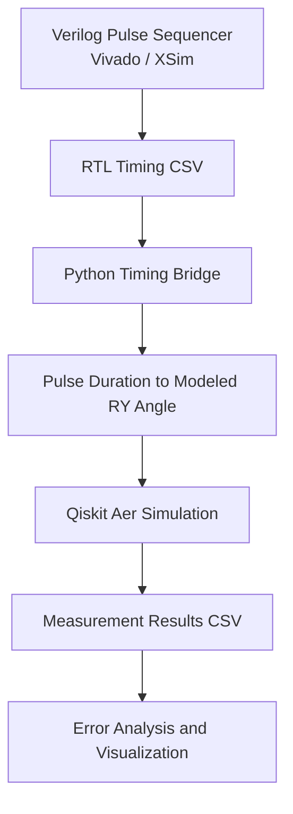
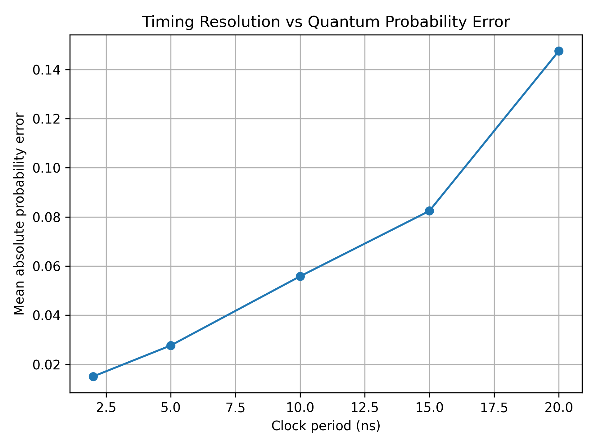
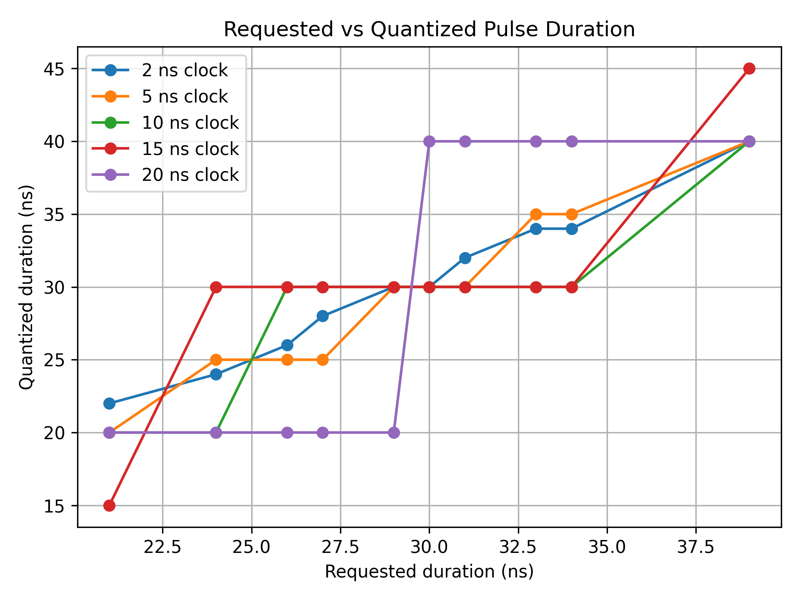
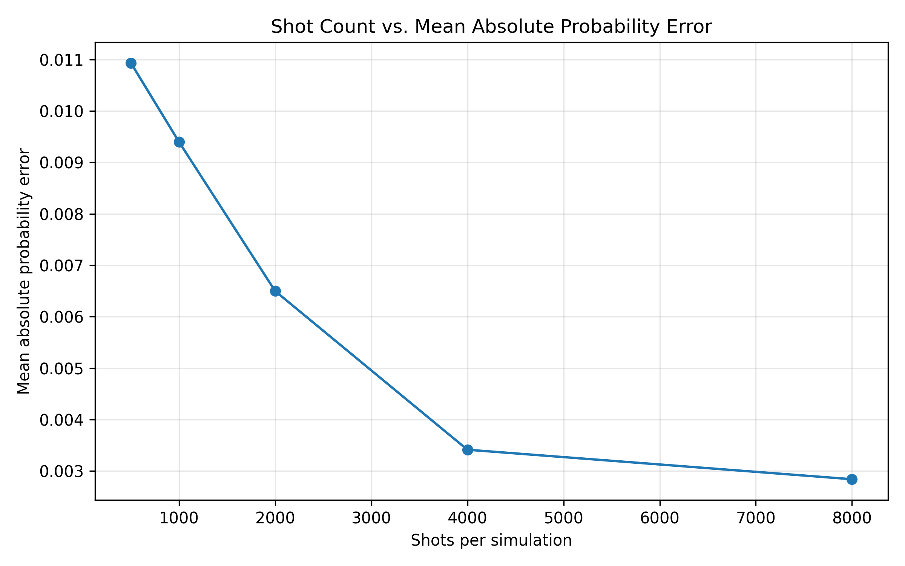
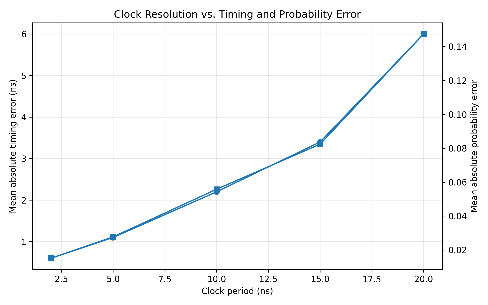

# QCtrl-QSim

### RTL-Aware Quantum Control and Readout Co-Simulation Framework

QCtrl-QSim is an experimental framework that connects Verilog-based digital pulse sequencing with Python analysis and Qiskit Aer quantum-circuit simulation.

The project investigates how finite digital timing resolution affects a simplified model of quantum rotation control.

## Project Objectives

- Implement a configurable pulse sequencer in Verilog.
- Verify pulse widths using Vivado behavioral simulation.
- Export RTL simulation measurements to CSV.
- Analyze timing results using Python.
- Simulate modeled rotation-angle changes using Qiskit Aer.
- Study timing quantization under different hypothetical clock periods.
- Improve reproducibility through controlled simulator seeds.

## Architecture

The framework consists of six layers:

1. **RTL layer:** Verilog pulse sequencer with configurable delay and pulse width.
2. **Verification layer:** Vivado testbenches for timing and edge cases.
3. **Data layer:** CSV exports from RTL simulation.
4. **Analysis layer:** Python timing calculations and validation.
5. **Quantum simulation layer:** Qiskit Aer circuits using RY rotations.
6. **Visualization layer:** Python plots and experiment reports.

### Architecture Diagram



### Workflow

1. **RTL generation:** The Verilog pulse sequencer generates control timing.
2. **Timing verification:** Vivado/XSim testbenches verify pulse timing and edge cases.
3. **Data transfer:** Simulated timing results are exported to CSV files.
4. **Quantum simulation:** Python maps pulse duration to a modeled rotation angle and simulates measurements using Qiskit Aer.
5. **Analysis:** Python scripts compare measurement probabilities with theoretical values and generate plots.

## Technology Stack

- Verilog HDL
- Xilinx Vivado / XSim
- Python
- Qiskit
- Qiskit Aer
- NumPy
- pandas
- Matplotlib

## Project Structure

```text
qctrl-qsim/
├── rtl/
│   └── pulse_sequencer.v
├── testbench/
│   ├── tb_pulse_sequencer.v
│   └── tb_pulse_edge_cases.v
├── python/
│   ├── timing_bridge.py
│   ├── quantum_experiment.py
│   ├── analyze_results.py
│   ├── quantization_study.py
│   ├── plot_results.py
│   ├── rtl_validation.py
│   ├── rtl_quantum_bridge.py
│   ├── resolution_sweep.py
│   ├── analyze_rtl_sweep.py
│   └── regression_summary.py
├── experiments/
├── results/
│   └── figures/
├── docs/
├── requirements.txt
├── .gitignore
└── README.md
```

## Verified Results

| Verification | Result |
|---|---:|
| RTL pulse-width sweep | 12/12 tests passed |
| RTL edge-case tests | 5/5 tests passed |
| RTL sweep analysis | 12/12 cases validated |
| Quantum simulation shots per configuration | 4,000 |
| Quantum simulation random seed | 42 |
| Mean absolute probability error (seeded run) | 0.00554 |

The RTL timing sweep covers three delay settings and four pulse widths. Edge-case tests cover reset behavior, idle behavior, zero-length commands, and reset during an active pulse.

The quantum simulation uses Qiskit Aer with a fixed simulator seed to make measurement sampling reproducible under the same inputs and software environment. The reported probability error is calculated by comparing finite-shot simulated measurement probabilities against theoretical probabilities.

These results are simulation-based. They do not represent measurements from physical quantum hardware or establish physical quantum-control accuracy.

## Results and Visualizations

### Resolution vs. Probability Error



This experiment compares probability error across hypothetical digital clock periods. The results illustrate how timing resolution affects the simplified model.

### Requested vs. Quantized Pulse Duration



This plot illustrates how requested pulse durations map to discrete timing intervals in the model.
### Statistical Evaluation: Shot Count vs. Probability Error



The statistical evaluation examines five pulse durations using three fixed simulator seeds (42, 123, and 2026) at five shot counts. This produces 75 simulation configurations.

| Shots per simulation | Mean absolute probability error |
|---:|---:|
| 500 | 0.010930 |
| 1,000 | 0.009397 |
| 2,000 | 0.006498 |
| 4,000 | 0.003415 |
| 8,000 | 0.002842 |

Across the tested configurations, the aggregate mean absolute probability error decreased by approximately 74.0% when the shot count increased from 500 to 8,000. Individual pulse configurations do not necessarily show a monotonic reduction.

These results characterize finite-shot sampling in an ideal simulated circuit. They do not establish physical quantum-control accuracy.
### Clock-Resolution Evaluation



The resolution sweep evaluates 50 modeled configurations across five hypothetical clock periods and ten requested pulse durations. Each requested duration is quantized to an integer number of clock cycles using nearest-cycle rounding, with a minimum of one cycle.

| Clock period | Mean absolute timing error | Maximum absolute timing error | Mean absolute probability error |
|---:|---:|---:|---:|
| 2 ns | 0.60 ns | 1 ns | 0.01506 |
| 5 ns | 1.10 ns | 2 ns | 0.02767 |
| 10 ns | 2.20 ns | 4 ns | 0.05582 |
| 15 ns | 3.40 ns | 6 ns | 0.08243 |
| 20 ns | 6.00 ns | 10 ns | 0.14748 |

Within this modeled sweep, the 2 ns clock period produced the lowest mean absolute probability error, while the 20 ns period produced the highest. The results illustrate the effect of timing quantization on the simplified duration-to-rotation model.

These clock periods are hypothetical evaluation settings, not measurements from different physical FPGA configurations. The probability errors compare modeled values against ideal values and do not establish physical quantum-control accuracy.

## Tested Environment

The following versions were reported from the development environment:

- Python: 3.13.1
- Qiskit: 2.5.2
- Qiskit Aer: 0.17.2
- NumPy: 2.2.3
- pandas: 2.2.3
- Matplotlib: 3.10.1

## Installation

Clone the repository:

```bash
git clone https://github.com/durga-naresh-10212/QCtrl-QSim.git
cd QCtrl-QSim
```

Install the required Python packages:

```bash
python -m pip install -r requirements.txt
```

Run Python scripts from the project root unless otherwise specified.

RTL simulation requires a compatible Xilinx Vivado installation. Add the RTL module and the desired testbench as design and simulation sources, then run behavioral simulation.

## Reproducibility

The quantum experiment uses the following configuration:

- Shots per configuration: 4,000
- Simulator seed: `42`
- Input: `results/timing_results.csv`
- Output: `results/quantum_results.csv`

Run the experiment and analysis from the project root:

```bash
python python/timing_bridge.py
python python/quantum_experiment.py
python python/analyze_results.py
```

The fixed seed makes the simulator's sampling reproducible when the inputs, software environment, and simulation settings remain unchanged.

The error-analysis output depends on the generated measurement probabilities. If the seed, shot count, timing data, or simulation configuration changes, regenerate the analysis and update any reported metrics accordingly.

## Modeling Assumptions and Limitations

- RTL verification is simulation-based, not physical FPGA testing.
- The Python-to-quantum bridge is file-based.
- The pulse-duration-to-rotation mapping assumes a simplified linear relationship under constant drive amplitude.
- Qiskit Aer results are simulated, not measured from a physical qubit.
- The timing-resolution sweep uses hypothetical clock periods; it does not establish measured performance across different FPGA configurations.
- Passing testbenches establishes only the behaviors covered by those tests.
- The current results do not establish research novelty or physical quantum-control accuracy.

## Future Work

- Automate RTL-to-Python data transfer.
- Expand regression tests and parameter sweeps.
- Compare quantization policies and timing-error metrics.
- Evaluate multiple fixed seeds and shot counts to quantify sampling variability.
- Add controlled noise models and compare ideal versus noisy simulations.
- Validate model assumptions and compare against relevant literature.
- Explore integration with more realistic quantum-control models.

## Research Scope

QCtrl-QSim is an exploratory engineering and simulation project. Its current results establish a working prototype and preliminary model-based observations. Further literature review and experimental validation are required to establish its research contribution.
