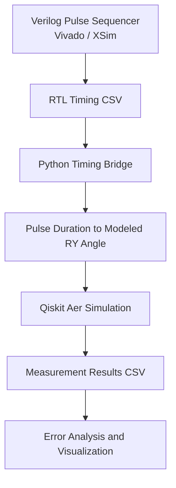

# QCtrl-QSim

### RTL-Aware Quantum Control and Readout Co-Simulation Framework

QCtrl-QSim is an experimental framework that connects Verilog-based digital pulse sequencing with Python analysis and Qiskit Aer quantum-circuit simulation.

The project investigates how finite digital timing resolution affects a simplified model of quantum rotation control.

## Project Objectives

- Implement a configurable pulse sequencer in Verilog.
- Verify pulse widths using Vivado behavioral simulation.
- Export RTL simulation measurements to CSV.
- Analyze timing results using Python.
- Simulate modeled rotation-angle changes using Qiskit Aer.
- Study timing quantization under different hypothetical clock periods.

## Architecture

The framework consists of six layers:

1. **RTL layer:** Verilog pulse sequencer with configurable delay and pulse width.
2. **Verification layer:** Vivado testbenches for timing and edge cases.
3. **Data layer:** CSV exports from RTL simulation.
4. **Analysis layer:** Python timing calculations and validation.
5. **Quantum simulation layer:** Qiskit Aer circuits using RY rotations.
6. **Visualization layer:** Python plots and experiment reports.

### Architecture Diagram



### Workflow

1. **RTL generation:** The Verilog pulse sequencer generates control timing.
2. **Timing verification:** Vivado/XSim testbenches verify pulse timing and edge cases.
3. **Data transfer:** Simulated timing results are exported to CSV files.
4. **Quantum simulation:** Python maps pulse duration to a modeled rotation angle and simulates measurements using Qiskit Aer.
5. **Analysis:** Python scripts compare measurement probabilities with theoretical values and generate plots.

## Technology Stack

- Verilog HDL
- Xilinx Vivado / XSim
- Python
- Qiskit
- Qiskit Aer
- NumPy
- pandas
- Matplotlib

## Project Structure

```text
qctrl-qsim/
├── rtl/
│   └── pulse_sequencer.v
├── testbench/
│   ├── tb_pulse_sequencer.v
│   └── tb_pulse_edge_cases.v
├── python/
│   ├── timing_bridge.py
│   ├── quantum_experiment.py
│   ├── analyze_results.py
│   ├── quantization_study.py
│   ├── plot_results.py
│   ├── rtl_validation.py
│   ├── rtl_quantum_bridge.py
│   ├── resolution_sweep.py
│   ├── analyze_rtl_sweep.py
│   └── regression_summary.py
├── experiments/
├── results/
│   └── figures/
├── docs/
├── requirements.txt
├── .gitignore
└── README.md
```

## Verified Results

| Verification | Result |
|---|---:|
| RTL pulse-width sweep | 12/12 tests passed |
| RTL edge-case tests | 5/5 tests passed |
| RTL sweep analysis | 12/12 cases validated |
| Mean absolute probability error | Approximately 0.00340 |

The timing sweep covers three delay settings and four pulse widths. Edge-case tests cover reset behavior, idle behavior, zero-length commands, and reset during an active pulse.

The probability error is from a finite-shot simulation comparison against theoretical probabilities. It is not a measurement of physical quantum hardware performance.

## Results and Visualizations

### Resolution vs. Probability Error


This experiment compares probability error across hypothetical digital clock periods. The results illustrate how timing resolution affects the simplified model.

### Requested vs. Quantized Pulse Duration


This plot illustrates how requested pulse durations map to discrete timing intervals in the model.

## Tested Environment

The following versions were reported from the development environment:

- Python: 3.13.1
- Qiskit: 2.5.2
- Qiskit Aer: 0.17.2
- NumPy: 2.2.3
- pandas: 2.2.3
- Matplotlib: 3.10.1

## Installation

Clone the repository:

```bash
git clone https://github.com/durga-naresh-10212/QCtrl-QSim.git
cd QCtrl-QSim
```

Install the required Python packages:

```bash
python -m pip install -r requirements.txt
```

Run Python scripts from the project root unless otherwise specified.

RTL simulation requires a compatible Xilinx Vivado installation. Add the RTL module and the desired testbench as design and simulation sources, then run behavioral simulation.

## Modeling Assumptions and Limitations

- RTL verification is simulation-based, not physical FPGA testing.
- The Python-to-quantum bridge is file-based.
- The pulse-duration-to-rotation mapping assumes a simplified linear relationship under constant drive amplitude.
- Qiskit Aer results are simulated, not measured from a physical qubit.
- The timing-resolution sweep uses hypothetical clock periods; it does not establish measured performance across different FPGA configurations.
- Passing testbenches establishes only the behaviors covered by those tests.
- The current results do not establish research novelty or physical quantum-control accuracy.

## Future Work

- Automate RTL-to-Python data transfer.
- Expand regression tests and parameter sweeps.
- Compare quantization policies and timing-error metrics.
- Add controlled noise models and reproducible repeated trials.
- Validate model assumptions and compare against relevant literature.
- Explore integration with more realistic quantum-control models.

## Research Scope

QCtrl-QSim is an exploratory engineering and simulation project. Its current results establish a working prototype and preliminary model-based observations. Further literature review and experimental validation are required to establish its research contribution.
